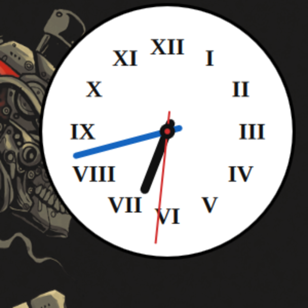
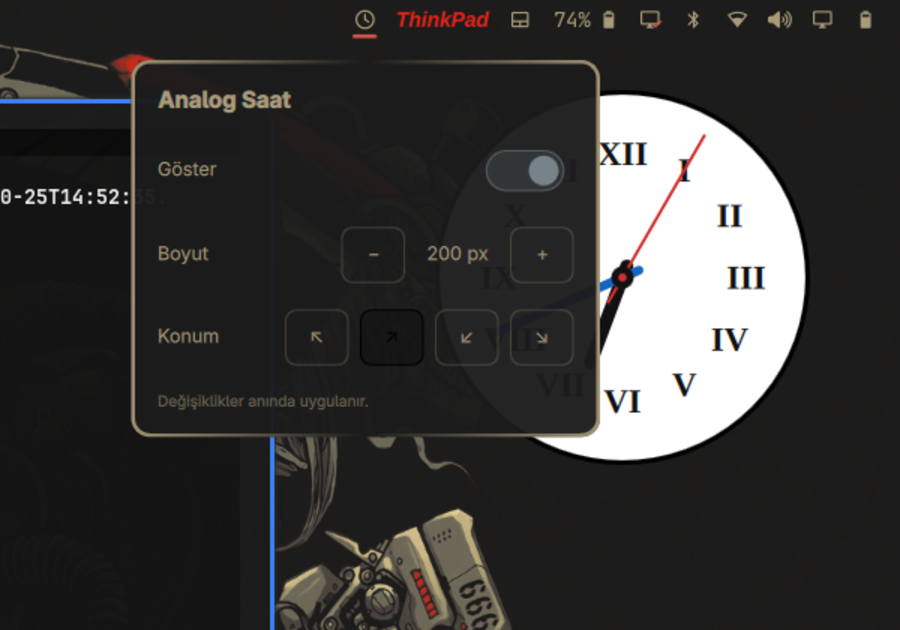

# Omarchy Analog Clock

Omarchy masaüstü için analog saat widget'ı. Masaüstü katmanında (pencerelerin
arkasında) beyaz kadranlı, Roma rakamlı bir saat çizer; boyutu ve konumu bar
menüsünden ayarlanır.



## Özellikler

- Beyaz kadran, siyah çerçeve ve Roma rakamları (XII … XI)
- Akrep siyah, yelkovan mavi, saniye kırmızı
- Ekranın dört köşesinden birine yerleşir, boyut 120–420 px arası ayarlanır
- Bar'daki saat ikonuna **veya masaüstündeki saatin üzerine** tıklayınca ayar
  menüsü açılır:
  - **Göster** — saati aç/kapa
  - **Boyut** — − / + (20 px adımlarla)
  - **Konum** — ↖ ↗ ↙ ↘
- Ayarlar anında uygulanır, shell yeniden başlatmak gerekmez
- Saat `WlrLayer.Bottom` katmanında olduğu için açık pencerelerin arkasında kalır

## Gereksinimler

- [Omarchy](https://omarchy.org/) (Quickshell tabanlı Omarchy shell)
- Qt 6 / Quickshell 0.3+

## Kurulum

### Git üzerinden (önerilen)

```bash
omarchy plugin add https://github.com/<kullanici>/omarchy-analog-clock --enable
```

`--enable` bar'a widget'ı ekler; servis (masaüstü saati) otomatik yüklenir.
Gerekirse konumu değiştirin:

```bash
omarchy bar move berat.analog-clock --section right
```

### Elle

```bash
git clone https://github.com/<kullanici>/omarchy-analog-clock
mkdir -p ~/.config/omarchy/plugins/berat.analog-clock
cp omarchy-analog-clock/{manifest.json,Clock.qml,BarWidget.qml} \
   ~/.config/omarchy/plugins/berat.analog-clock/
omarchy bar put berat.analog-clock --section right
omarchy restart shell
```

Kurulumu doğrulamak için:

```bash
omarchy plugin validate ~/.config/omarchy/plugins/berat.analog-clock
```

## Kullanım



- Bar'daki saat ikonuna veya masaüstündeki saate tıklayın.
- Menüden boyut ve köşe seçin; **Göster** anahtarıyla saati gizleyin.
- Menü klavyeden de kullanılabilir; dışına tıklayınca kapanır.

Ayar dosyası: `~/.config/omarchy/analog-clock.conf`

```ini
enabled=1
size=200
corner=tr
```

| Anahtar | Değerler | Varsayılan |
| --- | --- | --- |
| `enabled` | `1` / `0` | `1` |
| `size` | `120`–`420` (px) | `200` |
| `corner` | `tl`, `tr`, `bl`, `br` | `tr` |

Dosyayı elle düzenlerseniz de saat anında güncellenir. Dosya yoksa varsayılanlar
kullanılır.

## Nasıl çalışır?

- `BarWidget.qml` — bar ikonu, ayar menüsü ve ayarların dosyaya yazılması
  (`qs.Ui.Panel`, `qs.Ui.BarIconButton`, `qs.Ui.KeyboardPanel`)
- `Clock.qml` — `WlrLayer.Bottom` üzerinde çizilen saat yüzeyi; ayar dosyasını
  izler ve tıklamada `omarchy-shell berat.analog-clock toggle` ile menüyü açar
- Renkler ve ölçüler `Clock.qml` içindeki sabitlerden gelir; tema renkleri
  yalnızca menüde kullanılır (kadran her temada beyaz kalır)

QML dosyalarında değişiklik yaptıktan sonra `omarchy restart shell` gerekir.

## Lisans

[MIT](LICENSE)
